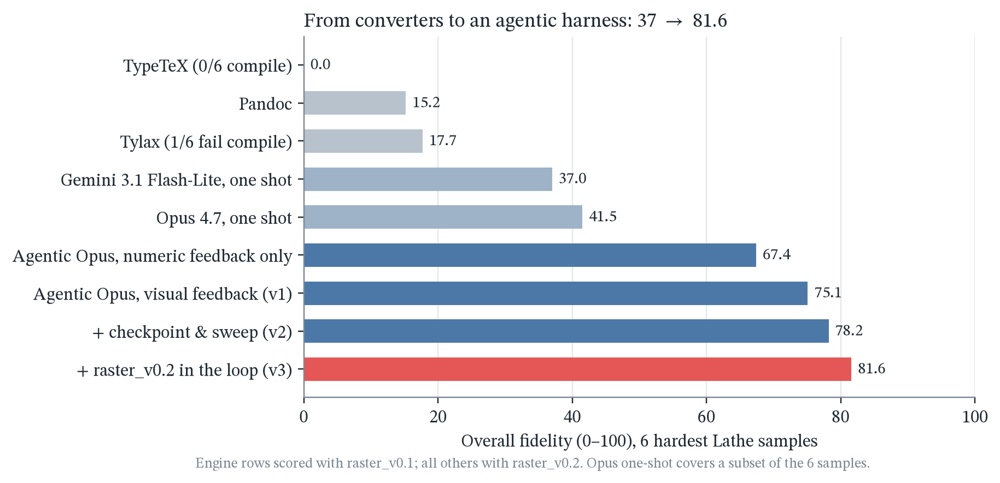
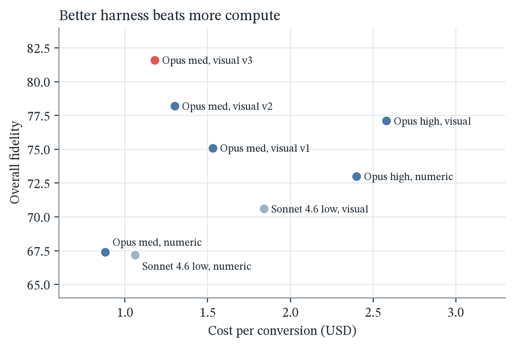
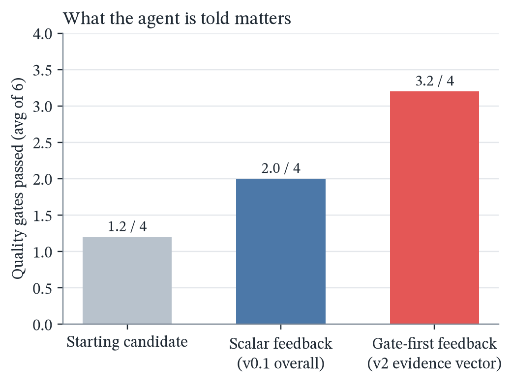
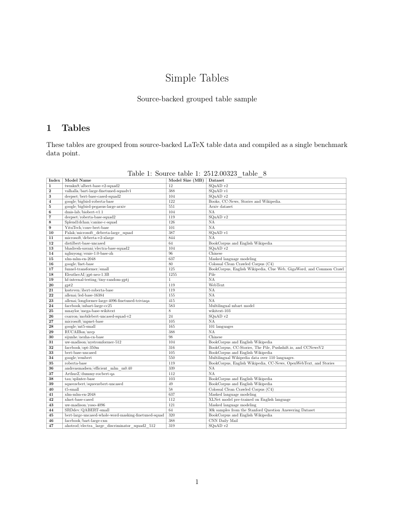
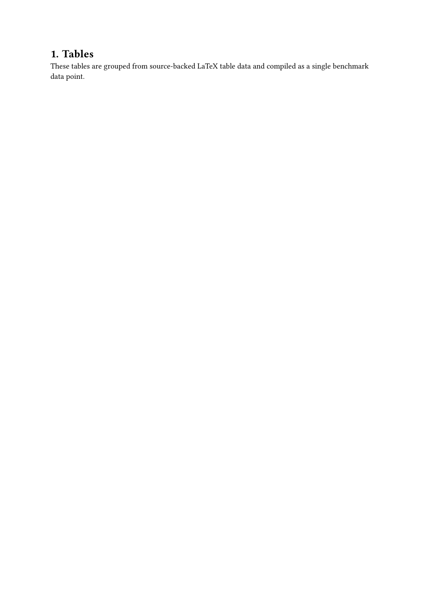
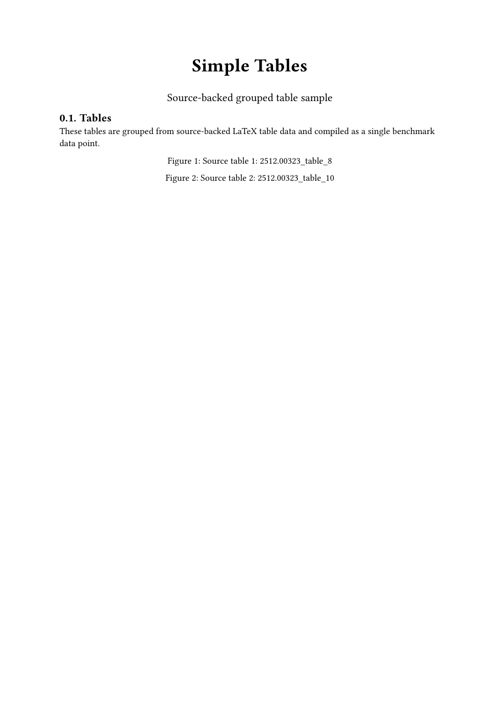
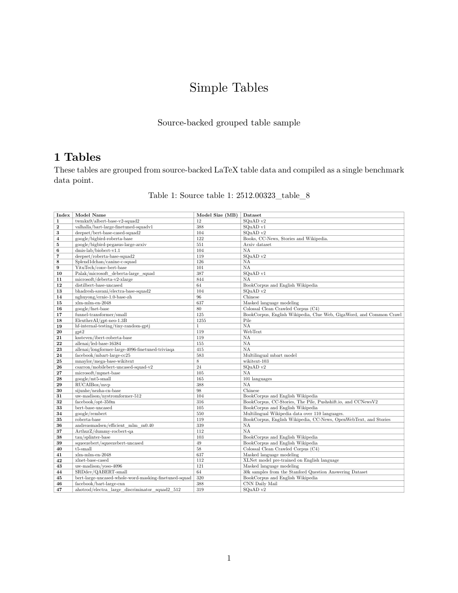
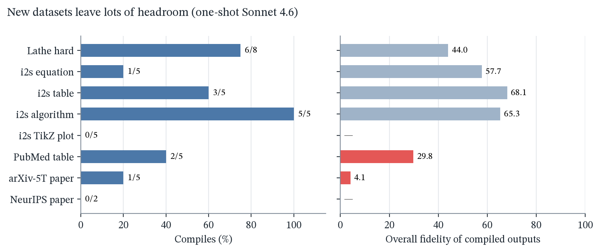

# typst-agent-harness

An agentic harness, reward design study, and hard datasets for **LaTeX → Typst
document conversion**, using compile and visual-fidelity feedback loops.

## Why

LaTeX is the default for scientific writing, but [Typst](https://typst.app) is
gaining ground: it compiles in milliseconds, has a real scripting language
instead of macro expansion, and gives readable errors. Moving the existing
LaTeX corpus over needs a converter that's faithful to the original layout,
not just to its text.

Using the [Lathe](https://github.com/yashashwi-s/lathe) benchmark, we found
glaring gaps in today's tools on the hardest samples (tables, algorithms,
figures, aligned math):

| converter | hard-set result |
|---|---|
| Pandoc | compiles, but keeps ~3% of table text, so table samples score ≈ 2/100 |
| Tylax | fails to compile 3 of 8 samples; 16–32/100 on the rest |
| TypeTeX | compiles 0 of 8 |
| Frontier LLM, one shot (Gemini 3.1 Flash-Lite / Sonnet 4.6 / Opus 4.7) | 37–43/100 overall, 0 of 6 pass the quality gates |



## What this repo adds

**1. An agentic harness that improves scores from 37 to 81.6.**
[`harness_baseline/run_task.py`](harness_baseline/run_task.py) wraps the
Claude Code CLI in an edit → compile → score loop. On each iteration the
agent sees the compiler errors, a per-axis fidelity breakdown, and
(optionally) visual diff images against the pdfLaTeX reference. It
checkpoints its best candidate and stops on plateau or budget.

Core 6 hardest samples, 0–100 (full table in
[`harness_baseline/RESULTS.md`](harness_baseline/RESULTS.md)):

| method | overall | layout | raster | gates passed | $/run |
|---|---:|---:|---:|---:|---:|
| One-shot Gemini 3.1 Flash-Lite | 37.0 | 30.6 | 7.3 | 0/6 | — |
| One-shot Opus 4.7 | 41.5 | 34.0 | 9.6 | 0/6 | — |
| Agentic, Opus, no visual feedback | 67.4 | 70.5 | 28.6 | 0/6 | 0.88 |
| Agentic, Opus, visual feedback (harness v1) | 75.1 | 71.4 | 46.8 | 2/6 | 1.53 |
| **Agentic, Opus, visual + raster_v0.2 in the loop (v3)** | **81.6** | **80.6** | **58.9** | 2/6 | 1.18 |

Ablations cover model (Sonnet / Opus), reasoning effort (low / medium / high),
feedback type (visual vs. numeric only) and harness version. Visual feedback
wins at medium effort, and an early pilot suggesting otherwise did not hold up
at scale. A better harness at medium effort also beats high effort at half
the cost.

<p>
  
  
</p>

Sample `05_tables_simple_005`, page 1. Both converters silently drop the
47-row table; the agentic harness reproduces it.

| pdfLaTeX reference | Pandoc | Tylax | Agentic harness |
|---|---|---|---|
|  |  |  |  |

**2. A fix for the reward.** The original raster metric topped out at about 25–30
even for faithful conversions. We traced this to the metric itself, not to the
models: a foreground-SSIM term that was dead (≈ 0.03 for every real pair) and
a ±2 px tolerance smaller than unavoidable cross-engine drift.
[`raster_v2.py`](harness_baseline/raster_v2.py) defines raster_v0.2 (identity
= 100, blank = 0, an 8 px whole-page shift ≈ 96) and rescores every stored
PDF with no new runs. The best raster score moved from about 30 to 78.9. This
is a change in measurement, not in model output, and both numbers are
reported.

**3. Gate-first feedback beats a single scalar score.**
[`metric_research/`](metric_research/) feeds an evidence vector with no single
score (hard gates first, continuous drivers second) to the agent instead of one
number. In an A/B on 6 hard samples, gate-first feedback matched or beat
scalar feedback on gates in 6 of 6 (3.2/4 vs. 2.0/4 gates on average), and
brought exact number-F1 to 1.000, at a small cost in raster polish. Report:
[`metric_research/report/metric_harness_report.pdf`](metric_research/report/metric_harness_report.pdf).

**4. Harder datasets.** [`dataset_expansion/`](dataset_expansion/) builds 7
new sample sets from public HuggingFace data: image2struct equations, tables,
algorithms and TikZ plots, PubMed clinical tables, and arXiv-5T and NeurIPS
full papers. One-shot results: full papers compile in 1 of 7 cases, TikZ plots
in 0 of 5. Even with the agentic harness, the hardest picks plateau at 58–67,
and every run stopped on plateau rather than budget, so these sets still leave
plenty of headroom. Corpus with provenance is in
[`dataset_expansion/corpus/`](dataset_expansion/corpus/).



## Ongoing: RL

The rewards here are deterministic (compile success + fidelity axes) and
unlabelled LaTeX is plentiful, so the task works well as an **RL
environment**. Work in progress: hill-climbing an open model with RL against
the gate-first reward, aiming to beat the frontier agentic numbers above,
with controlled ablations.

## Repo layout

```text
harness_baseline/   agentic + one-shot runners, feedback tools, raster_v0.2, results, report
  runs/<sample>__<visual|novisual|1turn>__<model>__<tag>/
                    prompt.txt, work/*.typ (final output), final_candidate.pdf,
                    summary.json, score JSONs, claude_transcript.jsonl.gz
dataset_expansion/  dataset builders, corpus + provenance, 1-turn and agentic runs, report
metric_research/    metric-v2 rescoring (phase A), gate-first feedback A/B (phase B), report
figures/            README charts (make_figures.py) and engine renders (make_engine_panels.py)
third_party/lathe   upstream Lathe benchmark (git submodule, pinned)
```

Every run ships its prompt, final Typst output, rendered PDF, scores and the
full agent transcript, so you can check any number in the tables yourself.
Transcripts are scrubbed of local paths and environment metadata.

## Reproduce

```bash
git clone --recurse-submodules https://github.com/avijit-thawani/typst-agent-harness
cd typst-agent-harness
mamba env create -f environment.yml && mamba activate typst-harness
# install typst (>= 0.15) and, for new datasets, tectonic

# regenerate the README figures (free)
python figures/make_figures.py

# every run's prompt, Typst output, PDF, scores and transcript are under */runs*/
# (per-iteration diagnostics are omitted for size, so make_results.py
#  reproduces scores but not the gate column)

# a new agentic run (paid: uses the Claude Code CLI)
python harness_baseline/run_task.py --help
```

## Credit

The benchmark dataset, deterministic-engine baselines, the original
`pdf_fidelity` v0.1 metric and `pdf_metric_axes_v2.py` come from
[Lathe](https://github.com/yashashwi-s/lathe) by Yashashwi S., included here
only as a submodule. This repo contains the harness, reward/metric
experiments and datasets built on top of it. Parts of this work were
upstreamed to Lathe as
[PR #1](https://github.com/yashashwi-s/lathe/pull/1),
[PR #2](https://github.com/yashashwi-s/lathe/pull/2) and
[PR #3](https://github.com/yashashwi-s/lathe/pull/3).

Released under the MIT License (see `LICENSE`). This covers only the code and
docs in this repo. Datasets keep their upstream licenses; see each corpus
provenance file.
